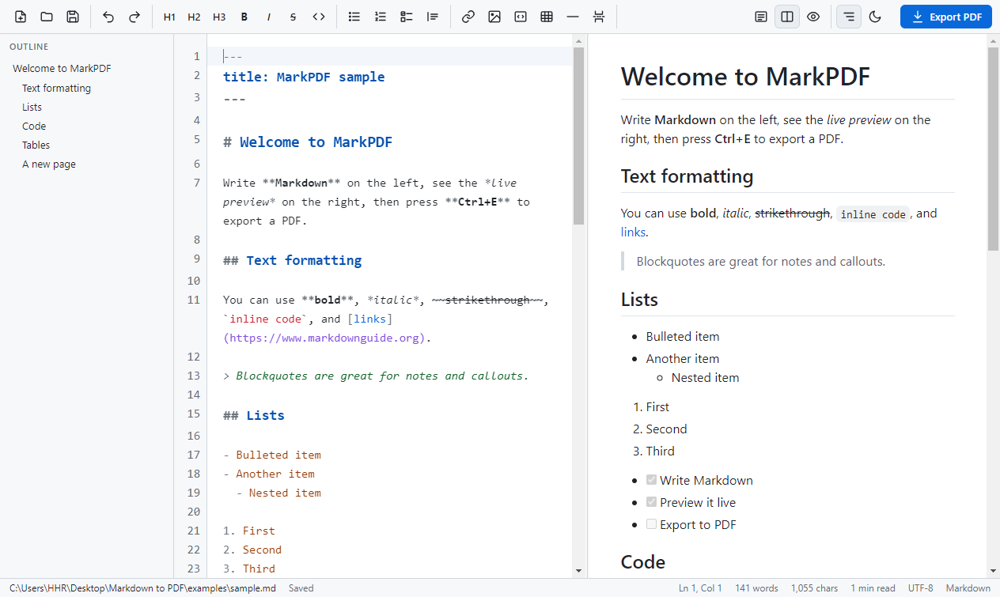

<p align="center">
  
</p>

<h1 align="center">MarkPDF</h1>

<p align="center">
  A Windows desktop Markdown editor with live side-by-side preview and one-click PDF export.<br>
  No online converters, no uploads. Everything runs on your PC.
</p>

<p align="center">
  
</p>

## Features

**Writing**
- Syntax-highlighted Markdown editor with line numbers and active-line highlight
- Live preview beside the editor, with GitHub-style rendering
- GitHub Flavored Markdown: tables, task lists, strikethrough, autolinks, fenced code
- Syntax highlighting for code blocks in 190+ languages
- Formatting toolbar and shortcuts for bold, italic, headings, lists, links, images, tables, code blocks and more
- Lists continue automatically when you press Enter
- Find & replace, go to line, insert date/time
- Spell check with right-click suggestions

**Files**
- New, Open, Save, Save As, with a list of recent files
- Asks you to save before closing or replacing a document with unsaved changes
- Drag and drop `.md` files to open them, or drop images to insert them as Markdown
- Registers as an editor for `.md` / `.markdown` files ("Open with → MarkPDF")
- Relative image paths (e.g. ``) resolve from the Markdown file's folder

**Export**
- **Export to PDF** with page size (A4, Letter, Legal, A3, A5, Tabloid), orientation, margins and page numbers
- Manual page breaks: `<!-- pagebreak -->` (Ctrl+Enter)
- Headings, code blocks, tables and images avoid breaking awkwardly across pages
- Export as a standalone HTML file, or print directly

**Interface**
- Editor-only, split, or preview-only layouts, with a draggable divider
- Document outline panel for jumping between headings
- Light, dark, or follow-system theme
- Scroll sync between editor and preview
- Adjustable font size, word wrap toggle
- Status bar showing line/column, word count, character count and reading time
- YAML front matter is hidden from the preview and export

## Install (Windows)

1. Download `MarkPDF Setup 1.0.0.exe` from the [Releases](../../releases) page, or build it yourself (see below).
2. Run the installer. You can choose the install folder; desktop and Start-menu shortcuts are created.
3. Windows SmartScreen may warn you because the installer is not code-signed. Click **More info → Run anyway**.

To uninstall, use **Settings → Apps → MarkPDF → Uninstall**.

## Keyboard shortcuts

| Action | Shortcut | | Action | Shortcut |
|---|---|---|---|---|
| New | `Ctrl+N` | | Bold | `Ctrl+B` |
| New window | `Ctrl+Shift+N` | | Italic | `Ctrl+I` |
| Open | `Ctrl+O` | | Strikethrough | `Ctrl+Shift+X` |
| Save | `Ctrl+S` | | Inline code | ``Ctrl+` `` |
| Save as | `Ctrl+Shift+S` | | Heading 1 / 2 / 3 | `Ctrl+1` / `2` / `3` |
| **Export PDF** | `Ctrl+E` | | Link / Image | `Ctrl+K` / `Ctrl+Shift+I` |
| Export HTML | `Ctrl+Shift+E` | | Bulleted / numbered list | `Ctrl+Shift+8` / `7` |
| Print | `Ctrl+P` | | Task list | `Ctrl+Shift+9` |
| Find / Replace | `Ctrl+F` / `Ctrl+H` | | Quote | `Ctrl+Shift+.` |
| Go to line | `Ctrl+G` | | Code block | `Ctrl+Shift+C` |
| Editor / Split / Preview | `Ctrl+Alt+1` / `2` / `3` | | Table | `Ctrl+Shift+T` |
| Outline | `Ctrl+Shift+O` | | Page break | `Ctrl+Enter` |
| Font size | `Ctrl+=` / `Ctrl+-` / `Ctrl+0` | | Cheat sheet | `F1` |

## Build from source

Requirements: [Node.js](https://nodejs.org/) 18 or newer and Windows 10/11.

```bash
git clone https://github.com/<your-username>/markdown-to-pdf.git
cd markdown-to-pdf
npm install

npm start              # run the app in development
npm run dist           # build the installer   → dist/MarkPDF Setup 1.0.0.exe
npm run dist:portable  # build a portable .exe (no install needed)
npm run icon           # regenerate build/icon.png from build/icon.svg
```

> **Troubleshooting `npm run dist`:** if the build fails with
> `Cannot create symbolic link : A required privilege is not held by the client`,
> either turn on **Developer Mode** in Windows Settings, or run the terminal as Administrator once.
> electron-builder needs to unpack a tools archive that contains symbolic links.
>
> If `npm start` opens Node instead of a window (common inside VS Code's extension host),
> clear the `ELECTRON_RUN_AS_NODE` environment variable first.

## Project structure

```
├── build/               # App icon (SVG source + generated PNG) used by the installer
├── docs/                # README screenshot
├── examples/sample.md   # Sample document showing supported syntax
├── scripts/make-icon.js # Renders icon.svg → icon.png
├── src/
│   ├── main.js          # Electron main process: windows, menus, file I/O, PDF/HTML export
│   ├── preload.js       # Secure bridge between the UI and the main process
│   └── renderer/
│       ├── index.html   # UI layout
│       ├── renderer.js  # Editor, live preview, formatting commands, sync scroll
│       ├── styles.css   # App styles (light/dark)
│       └── print.css    # Styles used for PDF / HTML / print output
└── package.json         # Scripts, dependencies, installer configuration
```

## Built with

- [Electron](https://www.electronjs.org/): desktop shell and Chromium's PDF engine
- [CodeMirror 5](https://codemirror.net/5/): editor
- [marked](https://marked.js.org/): Markdown parser
- [DOMPurify](https://github.com/cure53/DOMPurify): HTML sanitizing for the preview
- [highlight.js](https://highlightjs.org/): code highlighting
- [github-markdown-css](https://github.com/sindresorhus/github-markdown-css): GitHub-style preview
- [electron-builder](https://www.electron.build/): Windows installer

## Settings location

Preferences (theme, layout, PDF options, recent files) are saved in
`%APPDATA%\MarkPDF\settings.json`.

## License

[MIT](LICENSE)
